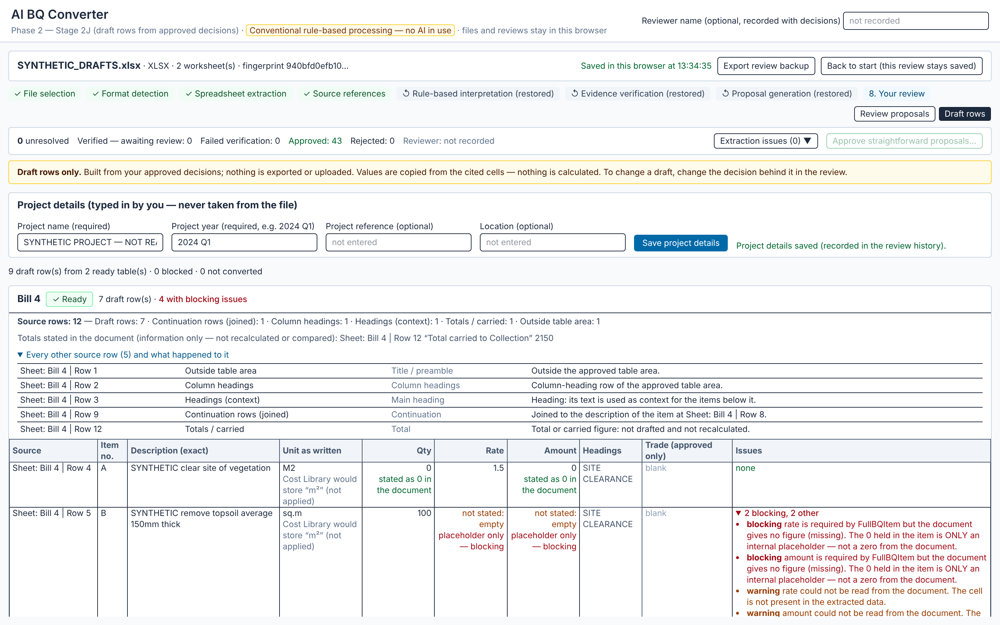
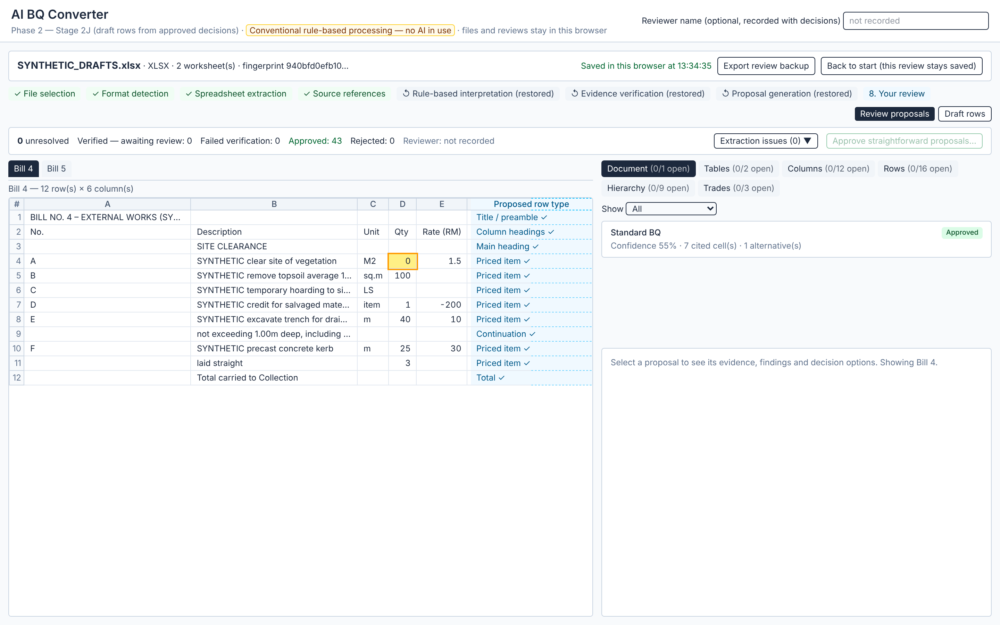

# Draft Rows (Stage 2J)

A plain-English guide to the **Draft rows** tab: the draft Cost Library rows (`FullBQItem`, wrapped in `StagedBQRow`) built from your approved decisions.

**Draft rows only.** Nothing is exported or uploaded. Drafts are not saved separately: they are rebuilt from your saved decisions each time, so they always match them. To change a draft, change the decision behind it in the review; the change is kept in the history.

## What is used

- **Only decisions you approved, or corrections you recorded.** Undecided proposals block their table. Rejected proposals are never used.
- **Values copied, never worked out.** Every value is copied from its own cell, exactly as the earlier stages read it:
  - The value rules (D-011, D-012) are unchanged.
  - Nothing is calculated: no quantity × rate, no extension, no total, no missing figure.
  - Totals written in the document are listed for information only.

## The six decisions

1. **Placeholder 0 is never a real zero.** If the document gives no quantity, rate or amount, `FullBQItem` still needs a number, so the draft holds 0 **as an internal placeholder only**.
   - It is listed as a placeholder, and its evidence says what was found (empty cell, "-", "Rate Only", "Nil" …).
   - It raises a **blocking** issue.
   - A "0" written in the document is a genuine zero. It is shown as "stated as 0 in the document" and has no placeholder.
2. **Lump sums.** A lump-sum unit ("LS", "L.S.") with no quantity keeps its quantity "not stated". It is never set to 1, and the rate is not worked out from the amount.
3. **Project name and year.** You type them in on the Draft rows tab; they are never taken from the file name. Until then, drafts still appear but every row has **blocking** issues. Saving them adds a "project details changed" entry to the review history.
4. **Units.** Kept exactly as written ("M2", "sq.m"). The Cost Library's spelling ("m²") is shown beside the unit and never applied.
5. **Unclassified rows.** These are not drafted and are listed with a warning:
   - rows whose type is "unknown"
   - rows whose proposed type was rejected without a correction
   - rows that never had a proposal

   Their type is never guessed.
6. **Tables are independent.** Each table needs its own table area, column meanings, row types and heading levels decided. A blocked table shows its reasons and never stops another, ready table.

## Continuation rows

- **Joining.** A continuation row is joined to the item that the approved heading levels say it belongs to. The texts are joined with one space, each exactly as written.
- **Evidence kept.** Every contributing cell is kept in the draft ("joined from 2 cells"), and the joined description is checked against those cells again (`verifyDrafts`).
- **Not attached by guesswork.** If it has not been decided which item a continuation belongs to, its table is blocked.
- **Other values not used.** Values on a continuation row outside the description column, such as a quantity, are not used. They raise a **blocking** issue on the item.

## Every source row is accounted for

Each table shows **Source rows: N**, split into:

- draft rows
- item rows of a blocked table
- continuation rows (joined)
- column headings
- headings (used as context)
- notes / preambles
- totals / carried
- titles / references
- blank rows
- ignored rows
- unclassified rows
- rows outside the table area
- undecided rows
- rows of tables not converted

The counts always add up to the number of rows in the worksheet. "Every other source row" lists each one and says what happened to it.

## Other checks

- **Negative values** keep their sign and raise a **blocking** issue (D-004).
- **Item numbers and descriptions** are copied exactly.
- **Headings** (bill, section, main, subheading) come only from the approved heading levels. If a heading's text cannot be identified without guessing, the field is left blank, with a warning.
- **Trade, Sub-trade, Cost Item and Element** are filled only from suggestions you approved (D-008). Otherwise they stay blank.
- **Progress claims** are never turned into BQ rows. A claim column in a table blocks that table.
- **Not yet supported:** additional quantity or amount columns, undetermined percentage columns, and Element, Trade or Cost Item columns. A table that uses one is blocked, not guessed.
- **Click to source.** Clicking any value shows its source cell in the review view.

## Older reviews

Reviews and backups saved by Stage 2I still load, import and reopen; they need no conversion. Their project details read as "not entered" until you type them in.

