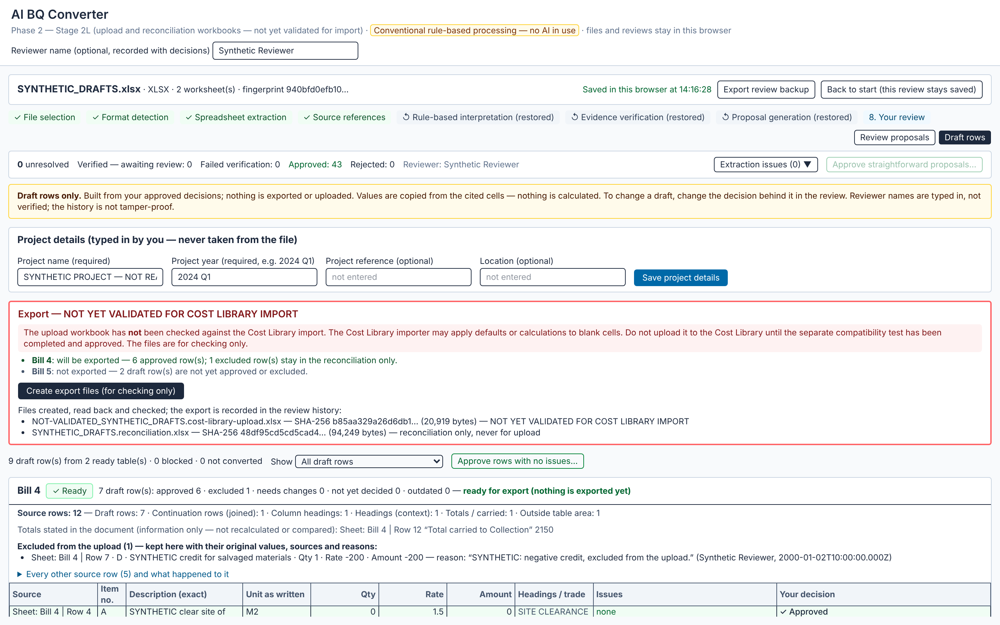
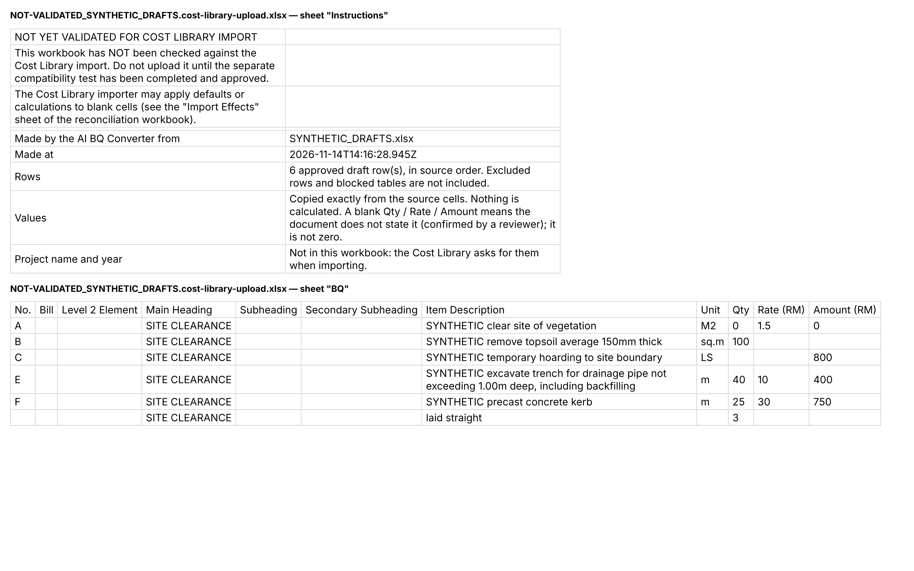
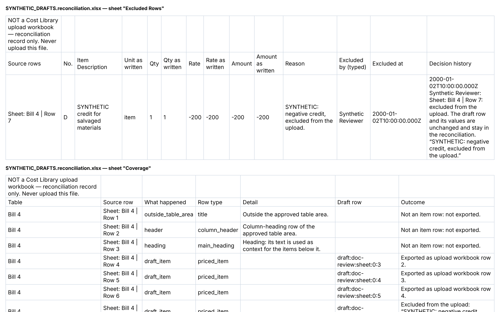

# Export (Stage 2L)

> **NOT YET VALIDATED FOR COST LIBRARY IMPORT.** The upload workbook has not been checked against the Cost Library's own import. The importer may apply defaults or calculations to blank cells. **Do not upload it** until the separate compatibility test has been completed and approved. The files are for checking only.

The **Export** panel on the Draft rows tab shows which tables will be exported and why the others won't. **Create export files (for checking only)** checks everything, writes the two workbooks, reads them back and checks them cell by cell, records the export in the review history, and downloads both files to your computer. Nothing is uploaded anywhere.

## When export is possible

- **Per table.** A table is exported when it is ready: every draft row approved or excluded, nothing outdated, and the project name and year entered. Ready tables are exported even if other tables are blocked; blocked tables are listed in the reconciliation and never appear in the upload workbook.
- **Refusals.** Nothing is produced, and the reasons are shown, if any of these is found:
  - the saved review fails its checks;
  - a draft no longer matches its source cells;
  - an exported row is not approved, or has an unresolved blocking issue;
  - an exported row has a negative figure;
  - a blank figure was not confirmed as "not stated";
  - a text is too long for an Excel cell;
  - either file differs from what was meant when it is read back.

## The upload workbook — `NOT-VALIDATED_<file>.cost-library-upload.xlsx`

- **Sheets.** An **Instructions** sheet (first line: NOT YET VALIDATED FOR COST LIBRARY IMPORT) and a **BQ** sheet. This is the Cost Library template layout, checked by reading the Cost Library code at commit `00491965` (read-only).
- **Columns, in order:** `No. | Bill | Level 2 Element | Main Heading | Subheading | Secondary Subheading | Item Description | Unit | Qty | Rate (RM) | Amount (RM)`.
- **Rows.** One row per **approved** draft row, in source order. Excluded rows, headings, notes and totals are left out.
- **Values,** copied exactly:
  - item numbers and descriptions as written ("1.10" stays "1.10"), and joined continuation descriptions;
  - units as written ("M2" stays "M2");
  - the bill heading as approved, or blank; Level 2 Element blank.
- **Blanks.** A Qty, Rate or Amount that the document does not state, and that a reviewer confirmed, is a **genuinely blank cell**. It is not 0, not "" and not calculated. A lump sum keeps its quantity blank.
- **Never in it:** negative figures (such rows can only be excluded), totals, formulas, or project name and year (the Cost Library asks for those when importing).
- **Text is always stored as text.** A description that looks like a formula ("=HYPERLINK(…)", "+SUM(…)", "@…") is kept as text and never becomes a formula.

## The reconciliation workbook — `<file>.reconciliation.xlsx`

Every sheet starts with **"NOT a Cost Library upload workbook — reconciliation record only. Never upload this file."**

| Sheet | Contents |
|---|---|
| Summary | Project details; source file and its SHA-256; who exported and when; the upload workbook's name and SHA-256; each table's status and counts; totals **stated** in the document, listed as written (no totals are calculated) |
| Line Trace | Each upload row → its table, draft row, **every** contributing source row, description cells, values as written, approval (name, time, note) |
| Coverage | **Every source row exactly once** and what happened to it (exported as row N, part of row N, excluded, heading, note, total, unclassified, not exported because its table is not ready …) |
| Excluded Rows | Original values (a negative stays e.g. -200), as written and as numbers, with the reason, who, when and the row's decision history |
| Issues & Resolutions | Every issue of every draft row, and how it was resolved or acknowledged |
| Placeholders | Every blank figure in the upload workbook, what the document shows, and the confirming note |
| Import Effects | What the Cost Library importer is **expected** to do. Every effect is marked "NOT YET CONFIRMED by the compatibility test". Examples: store 0 for a blank; calculate a blank amount as Rate × Qty or a blank rate as Amount ÷ Qty; read a row with no unit and no figures as a heading; respell units ("M2" → "m²"); skip rows marked "EXAMPLE" |
| Extra Columns | Values from columns with no Cost Library field |
| Decision History | The whole review history (names are typed in and not verified; not tamper-proof) |
| Blocked Tables | Tables not in the upload workbook, and why |

## The export is recorded

An **exported** entry in the review history keeps:

- the time;
- the name as typed;
- the tables and number of rows exported;
- each file's name, size and **SHA-256 fingerprint**.

## What is not done yet

- **The Cost Library import compatibility test.** It would run the Cost Library's own import on these files. It will be proposed separately and needs explicit approval.
- **Pricing options and several quantity columns** are not exported.
- **Claims** are never exported here.
