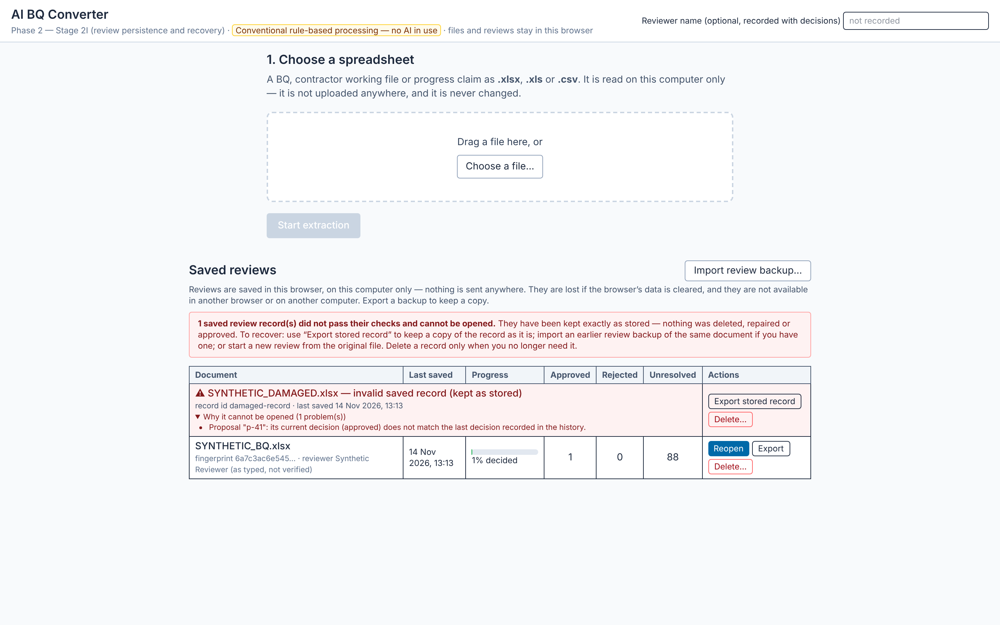
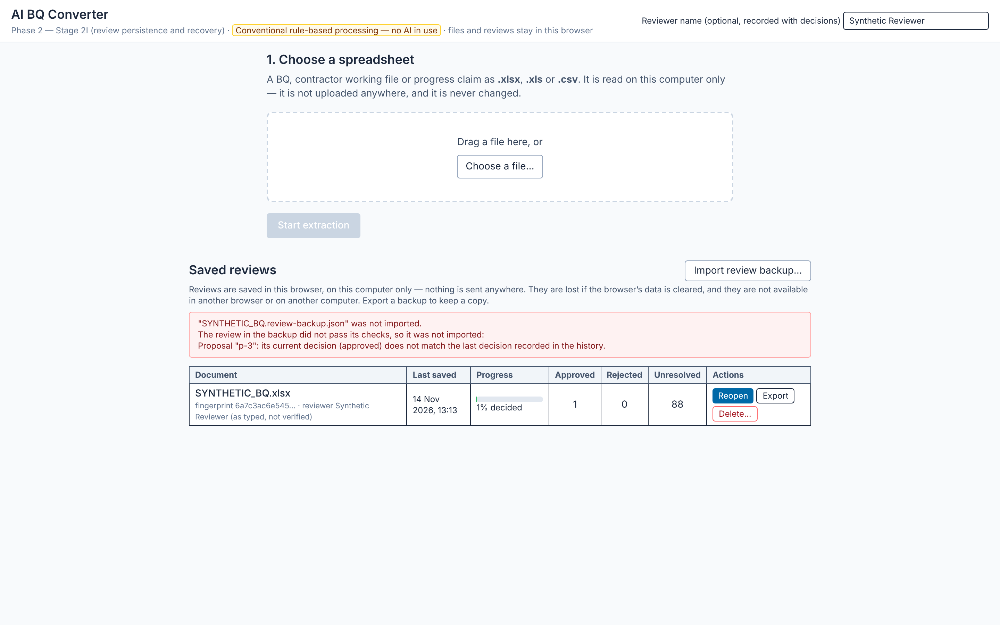
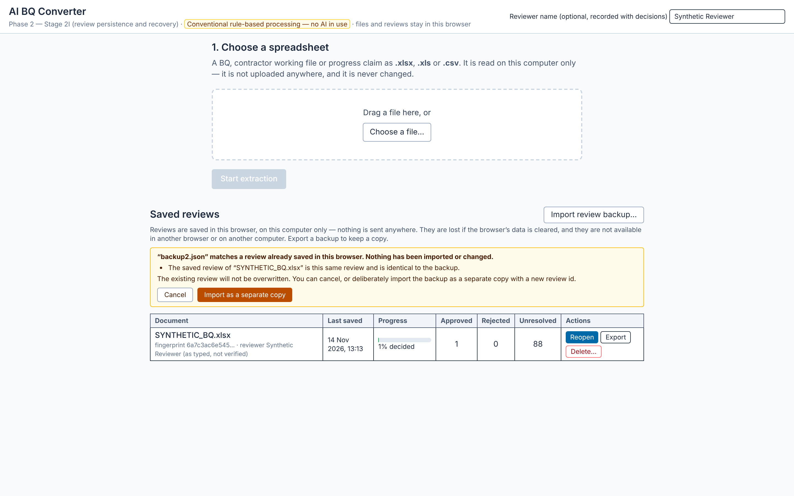

# Review Persistence and Recovery (Stage 2I)

Plain-English notes on how reviews are saved, checked, reopened and backed up. Everything stays **in your browser**. Nothing is uploaded.

## Important: what this does and does not protect against

- **Accidental damage is detected.** A backup that was changed or damaged after export, or a saved record that is incomplete or inconsistent, is refused or flagged. Inconsistent means, for example, a decision that does not match its history, or a history entry that is missing or out of order.
- **Deliberate tampering is not prevented.**
  - The backup's check code is an ordinary SHA-256 hash with no secret key or signature. Anyone who edits a backup can recalculate it.
  - The checks will still catch most careless edits, but a careful edit that keeps everything consistent cannot be detected.
- **The history is append-only through this application, but it is not tamper-proof.** The app never edits or removes a history entry. The records live in the browser and in backup files, where they can be edited outside the app. **Do not treat the review history as a secure audit trail.**
- **Reviewer names are not verified.** They are typed in by whoever uses the app. There is no sign-in, so a name is not an authenticated identity.

Real proof against tampering would need something outside the browser, such as a server or a signing key the user does not control. That would be a separate decision for a later stage.

## What is saved

A **saved review** (`src/core/review/reviewRecord.ts`) contains:

- the document's identity: file name, size, type, worksheets, and its **fingerprint**
  - the fingerprint is the SHA-256 of the file's complete bytes, not of its name, size or extracted content
- the extraction settings (for example, the CSV delimiter)
- every original proposal, with its evidence (cited cells, quoted text) and verification report
- the decisions: approved / rejected / unresolved, notes, acknowledged warnings, chosen alternatives and corrections
- the reviewer name as typed (or "not recorded") and the provider (`rule-based@0.1.0`)
- the project details (Stage 2J) and the decisions about draft rows (Stage 2K)
- the **history** of every change

It does **not** contain the file's contents. To reopen a review you choose the original file again.

## Where it is saved

- **Location.** The browser's built-in database (IndexedDB), in a database called `ai-bq-converter` (`src/storage/reviewStore.ts`). It is saved automatically after every decision.
- **One browser only.** It belongs to this browser and browser profile. Another browser or computer does not see it.
- **It can be lost.** Clearing site data, private/incognito windows, or the browser's own storage limits can remove it. **Export a backup** of reviews you want to keep.
- **No IndexedDB.** If IndexedDB is not available, reviews are kept in memory only, and the app says so.

## Checks on every saved review (`src/core/review/validate.ts`)

The same checks run when the app **lists** saved reviews, when a review is **opened or exported**, when a backup is **imported**, and before a review is **restored**:

1. **Structure.** Every required part is present and of the right type.
2. **Decision rules.** The same rules the review screen enforces:
   - no approval of a proposal that failed verification
   - warnings acknowledged with a note
   - every approval records which reading was chosen, and a chosen alternative must exist
   - a correction only with a rejection, with its explaining note, and unchanged since it was checked
   - an undecided proposal carries no decision
3. **History consistency.**
   - The history starts with "review created" and is numbered 1, 2, 3… with nothing missing.
   - There is one "proposal created" entry per proposal.
   - Every change starts from the state the previous entry left. An approval with warnings has its "warning acknowledged" entry, and an approved alternative has its "alternative chosen" entry.
   - The names and notes in the history match the decisions.
   - The last recorded state of every proposal is its current decision.

Reopening also re-verifies every proposal against the original file's cells. It also checks that every correction still fits those cells.

## A saved review that fails its checks

- **What you see.** The saved reviews list shows a warning, and the record is marked **invalid saved record (kept as stored)**. "Why it cannot be opened" lists the reasons. The record cannot be reopened.
- **What happens to it.** It is kept **exactly as stored**: it is never deleted, overwritten, repaired or approved automatically. Your other saved reviews are not affected.
- **How to recover:**
  1. **Export stored record** downloads the record exactly as it is stored (`<record id>.stored-record.json`), so you keep a copy. It is not a review backup and cannot be imported as one.
  2. If you have an earlier **review backup** of the same document, import it.
  3. Otherwise, start a new review from the original file.
  4. Delete the invalid record (it asks for confirmation) only when you no longer need it.

## Reopening a review

1. Click **Reopen** and choose the original file.
2. The file's fingerprint is compared with the saved one. **A matching file name is not enough.**
   - If they differ, nothing is restored.
   - The saved review is kept, and you may review the new file as a separate review.
3. If it matches, the file is read again with the saved settings. **Every saved proposal is re-verified** against it, and the whole record is checked (`src/core/review/restore.ts`). If anything does not fit, nothing is restored, and the reasons are shown.
4. A "review restored" entry is added to the history.

Choosing a file that already has a saved review offers **Continue this review** or **Start a new, separate review**.

## Decision history

Each entry has:

- a sequence number
- the time
- the name as typed (or "not recorded")
- the action
- the note
- the decision before and after

Actions:

- review created
- proposal created
- approved
- rejected
- correction recorded
- alternative chosen
- warning acknowledged
- decision reopened
- review restored
- review imported

The app never edits or removes an entry. To change a decision, **Change this decision** reopens it, and the earlier decision remains in the history. See the warning at the top: this is an application rule, not tamper-proofing.

## Backup export and import

### Export

**Export review backup** downloads `<file name>.review-backup.json` (`src/core/review/backup.ts`). It contains:

- the whole saved review
- a notice that it is **NOT a Cost Library upload workbook**
- an ordinary SHA-256 checksum

It contains no recalculated or new BQ figures.

### Import

**Import review backup…** (`src/storage/importReview.ts`) reads the file and checks it. The file itself is never changed. It refuses the file, with the reasons, if it is:

- empty
- a spreadsheet
- not JSON
- another kind of JSON
- a different format version
- missing parts
- changed or damaged (checksum)
- failing any of the decision or history checks above

### Same backup twice

A backup is recognised as already present in two ways:

- **Same review id:** a saved review has the same review id (the original, unchanged or with newer decisions).
- **Same content:** the same backup content was imported before. Each "imported" history entry records the backup's content checksum.

Either way the import stops and says so. Nothing is imported or changed. You can **Cancel** or deliberately **Import as a separate copy**, which gets a new review id.

### Never overwritten

- New reviews and imports are stored with IndexedDB's `add`, which refuses an id that already exists inside a single transaction.
- Two imports at the same moment therefore cannot overwrite an existing review or each other: one is stored and the other gets the duplicate warning.
- An existing review's decisions are never overwritten by an import.

### After importing

An imported review still needs the original file to reopen.
