# User Interface (Stages 2H–2J)

A plain-English guide to using the app. Everything runs **in your browser**: the file is not uploaded anywhere, and it is never changed.

Start the app with:

```bash
npm run dev
```

Then open the address it prints (normally http://localhost:5173).

## 1. Choose a spreadsheet

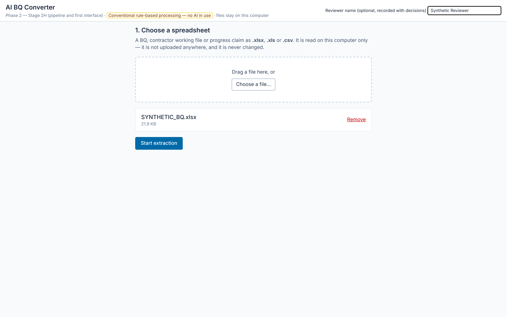

1. Optionally, type your name in **Reviewer name**. It is recorded with each decision. If it is left empty, decisions say "not recorded"; no name is invented.
2. Drag an `.xlsx`, `.xls` or `.csv` file into the box, or click **Choose a file…**. The name and size are shown. **Remove** clears it.
3. For CSV files, the delimiter and encoding are detected automatically. If detection fails, the CSV settings are highlighted so you can choose them and try again.
4. Click **Start extraction**.

## 2. The pipeline

The file goes through: file selection → format detection → spreadsheet extraction → source references → rule-based interpretation → evidence verification → proposal generation → **your review**. Each stage shows ✓ when done.

If a stage fails, processing **stops** and the screen says which stage failed and why. Nothing is extracted or proposed from that file.

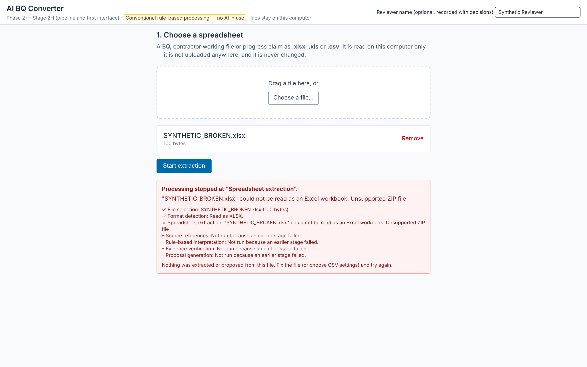

## 3. Review

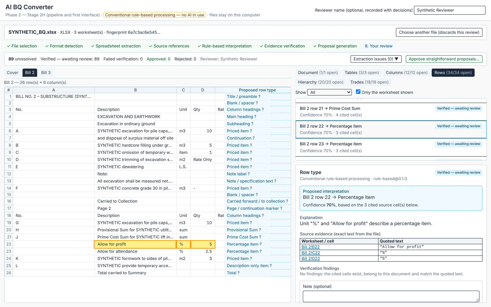

**Left: the extracted source, complete.**
- Use the worksheet tabs to switch sheets. Hidden and very hidden sheets are marked.
- Every row is shown in its original position, with Excel row numbers and column letters. Blank rows are included.
- Hover over a cell to see its stored value, shown text, type, number format and formula.
- The dashed **Proposed row type** column on the right is the *proposal*, kept apart from the source. "?" means unresolved, ✓ approved, ✗ rejected.

**Top bar.** It shows how many proposals are unresolved, verified (awaiting review), failed verification, approved and rejected. It also gives access to the extraction issues, with links to the cells concerned.

**Right: the proposals,** grouped as Document, Tables, Columns, Rows, Hierarchy and Trades. You can filter to "Unresolved only" or "Needing attention", and limit the list to the worksheet shown.

**Selecting a proposal shows its evidence:**
- the proposed interpretation
- its confidence, always together with the cited cells it is based on
- the explanation
- each cited cell's exact worksheet / cell reference and the exact quoted text (click a reference to highlight that cell in the source)
- the alternative interpretations
- every verification finding

The cited cells are highlighted in yellow.

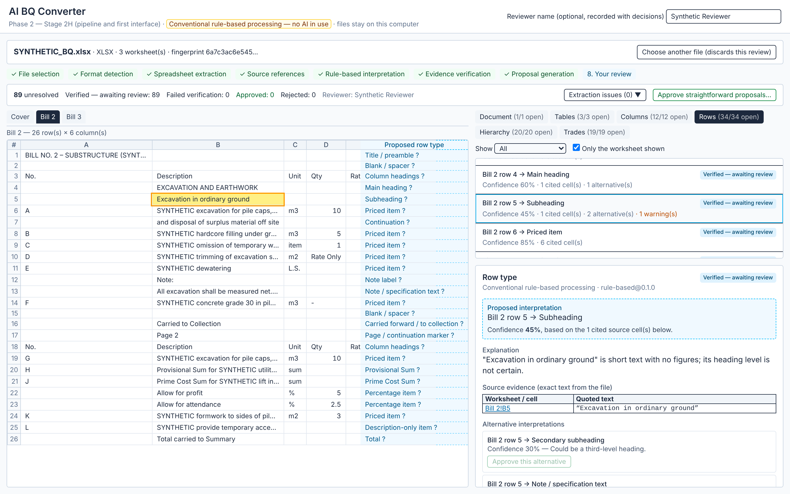

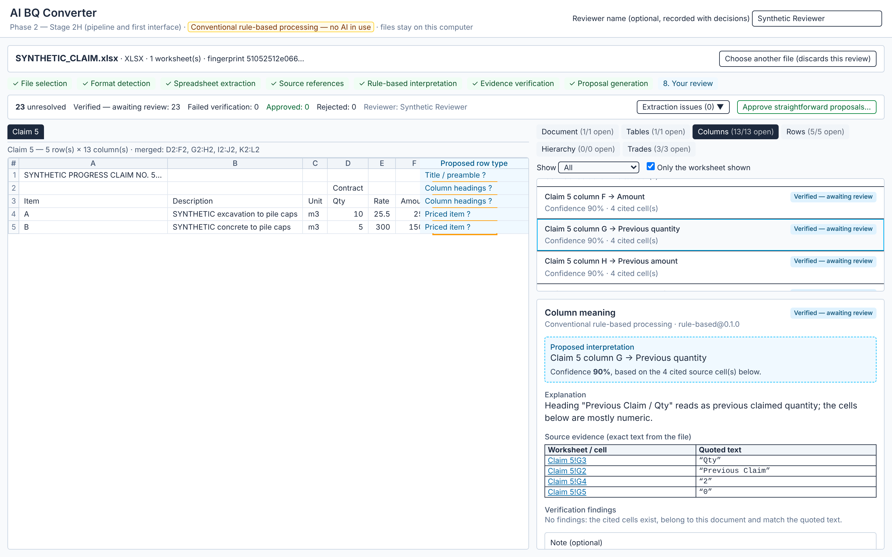

## 4. Decisions

| You can | Rules |
|---|---|
| **Approve** | Not possible when verification found a **blocking** problem. With **warnings**, a note acknowledging them is required. With **alternatives**, choose "Approve the proposed reading" or "Approve this alternative". |
| **Reject** | A note is optional. |
| **Reject and record a correction** | Choose the right value (document type, column meaning or row type) and write a note. The correction is checked against the same cited cells and stored **separately**; the proposal and the source are unchanged. |
| **Leave it unresolved** | Do nothing. It stays in the unresolved count. |

**Approve straightforward proposals…** approves, after you confirm, only table, column and row proposals that have no alternatives and no warnings. Document type, hierarchy, trade suggestions and anything ambiguous always stay for individual review.

Passing verification is not approval. Nothing is approved unless you approve it.

## 5. Saved reviews (Stage 2I)

Every decision is **saved automatically in this browser**. The header of the review shows "Saved in this browser at …".

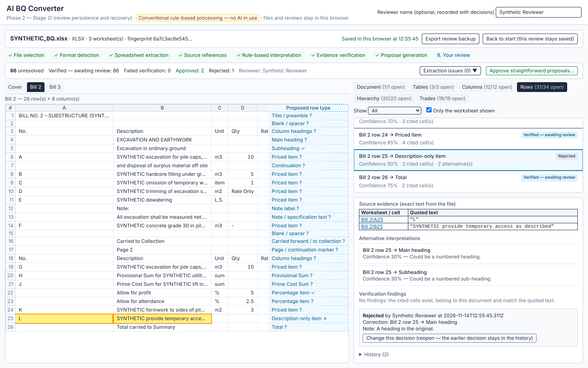

The start screen lists **Saved reviews in this browser**: document name, fingerprint, reviewer, last saved, progress, and approved / rejected / unresolved counts, with **Reopen**, **Export** and **Delete…** (delete asks for confirmation).

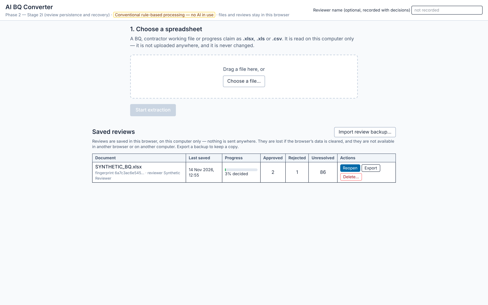

**Reopen** asks you to choose the original file again. The review does not store your document, only the decisions about it. A matching file name is not enough: the file's fingerprint (SHA-256 of its bytes) must match.

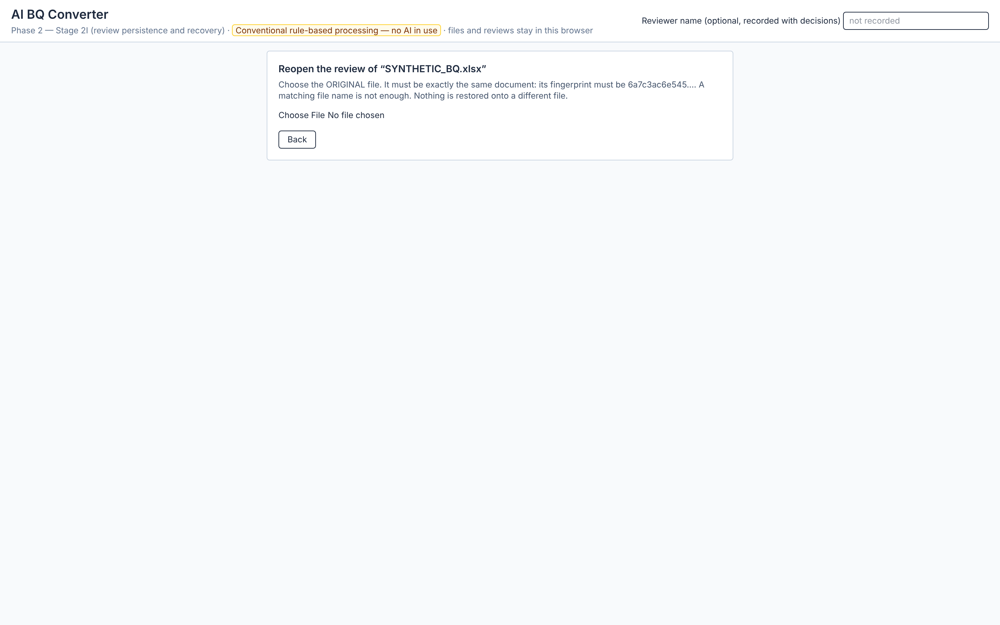

If the fingerprint does not match, nothing is restored. You can choose another file, or review the file you chose as a new, separate review. The saved review is kept unchanged.

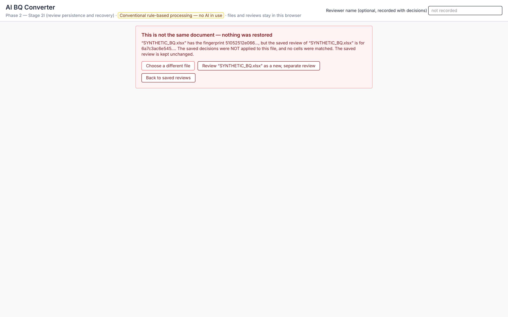

When it matches, every saved proposal is checked again against the file before it is shown. Stages that were not re-run are marked "↺ (restored)". Each proposal shows its **History**. **Change this decision** reopens it; the earlier decision stays in the history.

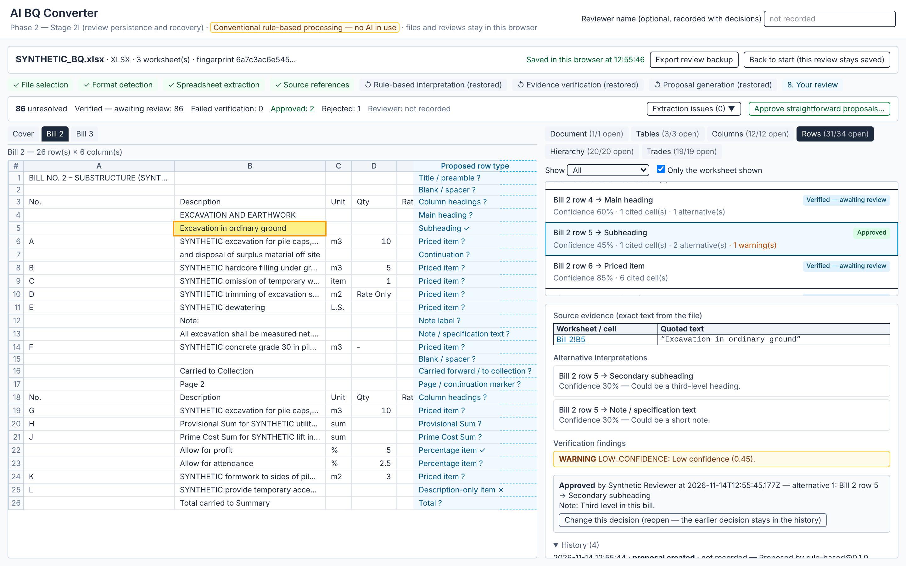

**Backups.** "Export review backup" downloads a `.review-backup.json` file. "Import review backup…" loads one back after checking it completely. If the backup matches a review already saved, you are warned and can cancel or import it as a separate copy; nothing is overwritten.

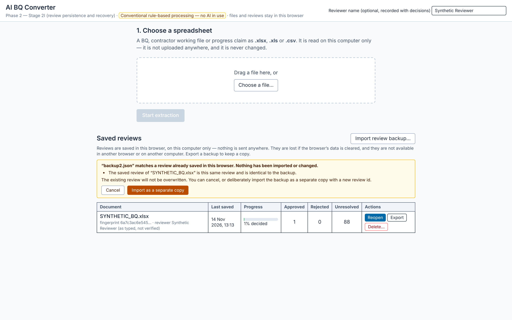

**Damaged saved records.** A saved review that fails its checks is shown as invalid, with the reasons. It is kept exactly as stored and can be exported as it is.

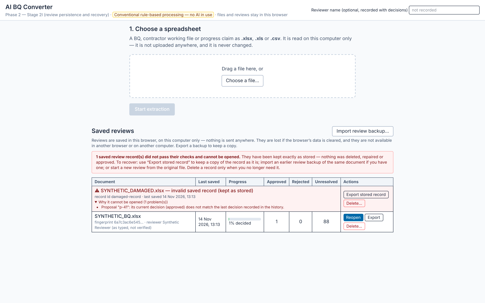

Reviewer names are typed in and are not verified identities. The history is not tamper-proof. Details: [`REVIEW_PERSISTENCE.md`](REVIEW_PERSISTENCE.md).

## 6. Draft rows (Stage 2J)

The **Draft rows** tab (next to "Review proposals") shows the draft Cost Library rows built from your approved decisions. Nothing is exported. Details: [`DRAFT_ROWS.md`](DRAFT_ROWS.md).

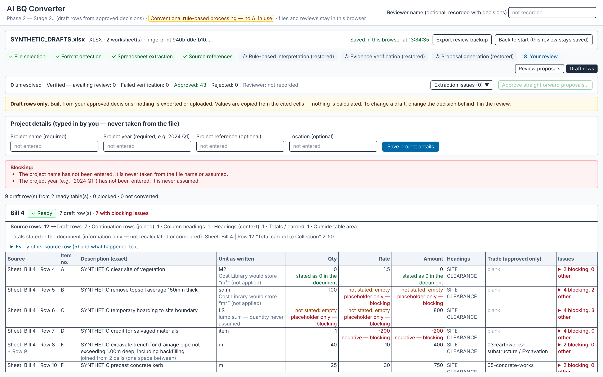

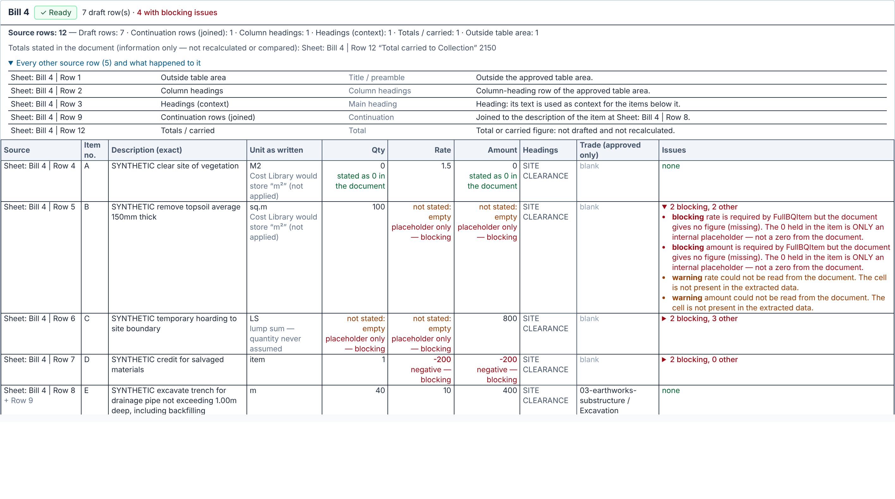

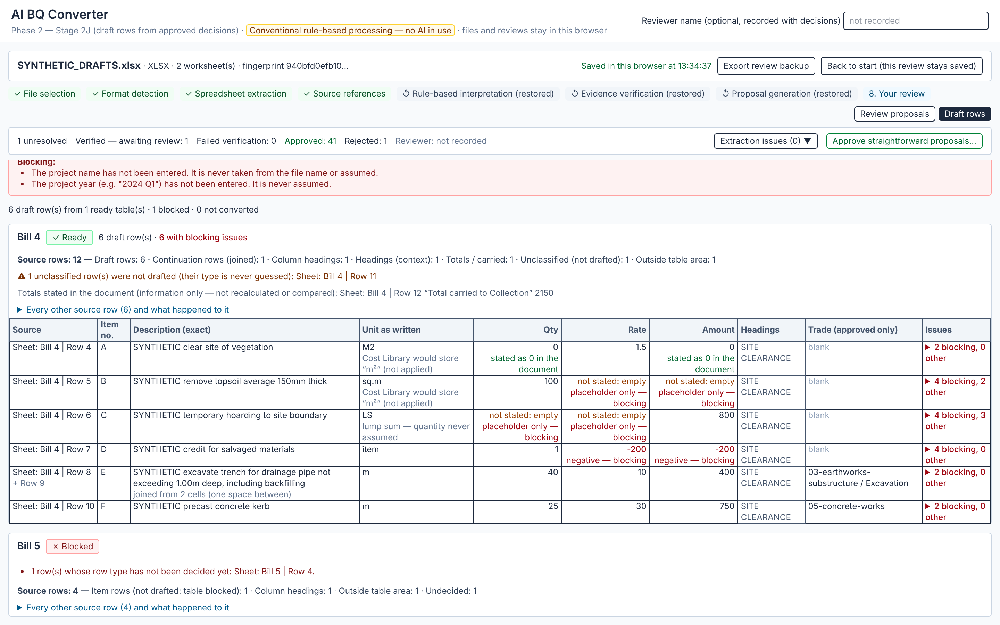

Since Stage 2K, each draft row also has **Decide / resolve…**: you can resolve blocking issues, approve the row, mark it as needing changes, or exclude it from the upload. Details: [`DRAFT_ROWS.md`](DRAFT_ROWS.md#your-decisions-about-draft-rows-stage-2k).

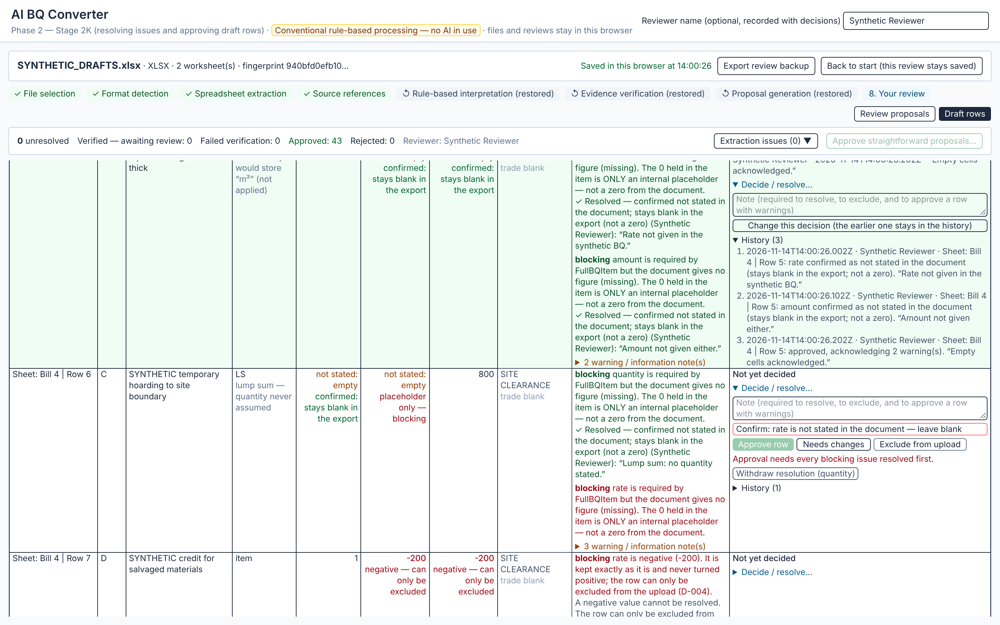

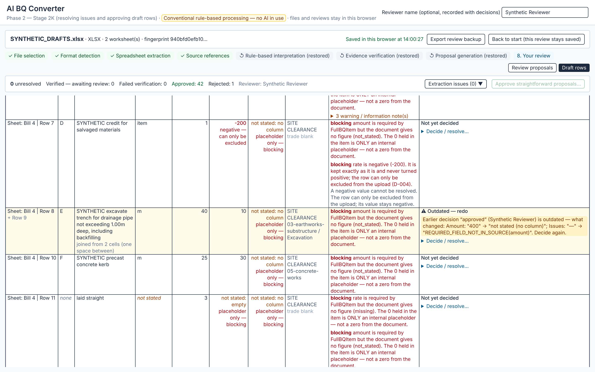

## 7. Not yet

- There is no export to the Cost Library yet.
- PDF and OCR are later phases.
